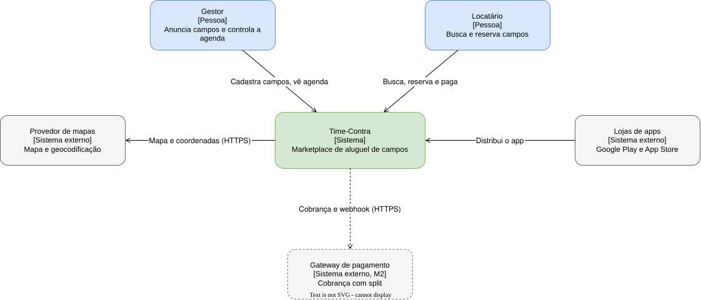

# Arquitetura

Estrutura em seções do arc42 e diagramas no modelo C4. O que ainda não foi construído aparece com o marco que
o constrói.

## 1. Objetivo

O sistema liga gestores de campos de futebol a locatários: o gestor anuncia o campo e controla a agenda, o
locatário encontra um campo no mapa e reserva um horário. Os objetivos de qualidade são os requisitos
não funcionais do [SRS](../requirements/README.md#requirements).

## 2. Restrições

Estão em [Visão geral dos requisitos](../requirements/overview.md).

## 3. Contexto e escopo

| Ator ou sistema | O que troca com o Time-Contra | Marco |
| --- | --- | --- |
| Gestor | Cadastra campos, horários e preços; consulta a agenda, os pagamentos e as visualizações | M1 |
| Locatário | Busca campos, reserva horários; no M2, paga pelo app e cria campeonatos | M1 |
| Provedor de mapas | Mapa e geocodificação dos endereços; o fornecedor é escolhido na spec da busca | M1 |
| Gateway de pagamento | Recebe o pagamento, retém a comissão e repassa ao gestor; o fornecedor é escolhido na spec de pagamento | M2 |
| Lojas de apps | Distribuem o app para Android (Google Play) e iOS (App Store) | M1 |

## 4. Estratégia de solução

- Um app [Flutter](building-blocks/app.md) para Android, iOS e web, em MVVM, como manda o guia de arquitetura
  do Flutter. As regras de dependência entre camadas estão no `AGENTS.md` da raiz.
- O backend é o [Supabase](building-blocks/supabase.md): o app lê e grava direto no Postgres pela API do
  Supabase, e as regras que o banco consegue garantir (reserva única, isolamento entre gestores) ficam nele.
- Código de servidor próprio só onde há segredo ou terceiro: Edge Functions para o pagamento, no M2.

## Índice

| Seção arc42 | Onde |
| --- | --- |
| 5. Blocos | [building-blocks/](building-blocks/README.md) |
| 6. Cenários em execução | [runtime/](runtime/README.md) |
| 7. Implantação | [deployment.md](deployment.md) |
| 8. Conceitos transversais | [concepts/](concepts/README.md) |
| 9. Decisões | Em `docs/decisions/`, criada pela primeira ADR |
| 10. Requisitos de qualidade | Os NFRs do [SRS](../requirements/README.md#requirements) |
| 11. Riscos e dívida técnica | [risks.md](risks.md) |
| 12. Glossário | [Glossário](../requirements/glossary.md) |
