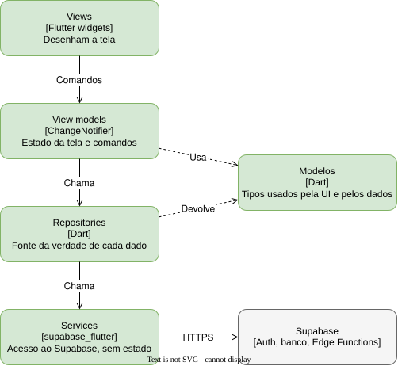

# App

Um código Flutter que roda como app de Android, de iOS e como site. Mostra as telas do gestor e do locatário
e conversa com o Supabase.

## O que nunca faz

- Guardar uma regra que o banco consegue garantir. A reserva única por horário e o isolamento entre gestores são
  do [banco](supabase.md#banco).
- Falar com o gateway de pagamento. Isso é das [Edge Functions](supabase.md#edge-functions).
- Guardar segredo. O app só tem a chave pública do Supabase.

## Partes

| Parte | Pasta | Responsabilidade |
| --- | --- | --- |
| Views | `lib/ui/<feature>/widgets/` | Desenhar a tela e repassar ao view model o que o usuário faz |
| View models | `lib/ui/<feature>/view_models/` | Estado da tela e comandos que a view chama |
| Repositories | `lib/data/repositories/` | Fonte da verdade de cada tipo de dado; cache e tratamento de erro |
| Services | `lib/data/services/` | Acesso ao Supabase e às APIs da plataforma, sem estado |
| Modelos | `lib/domain/models/` | Tipos de dado usados pela UI e pelos dados |

As features são as áreas do SRS: contas, campos, busca, reservas, pagamentos, visualizações e campeonatos.

## Para mudar com segurança

As regras de quem importa quem estão na seção Architecture do `AGENTS.md` da raiz, e o `/tightship:audit`
cobra essas regras.
