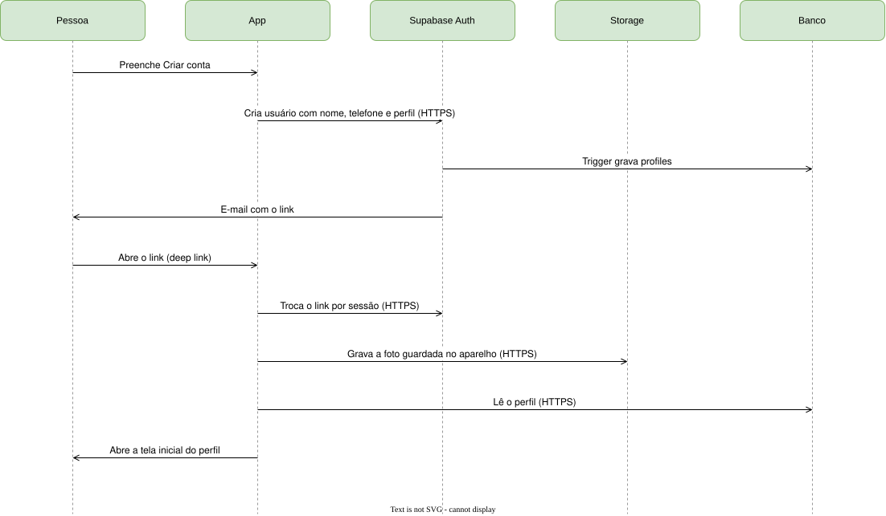

# Criar conta e entrar

M1. Cobre FR-ACC-01, FR-ACC-02 e BR-05. Detalhes na
[spec 1.1](../../specs/1-accounts-access/sign-up-and-sign-in.md).

1. A pessoa preenche Criar conta, e o app pede ao Supabase Auth a criação do usuário com nome, telefone e
   perfil (HTTPS).
2. Um trigger do banco grava a linha de `profiles` com esses dados.
3. O Supabase Auth envia o e-mail com o link de confirmação. Até a confirmação não há sessão, e a foto fica no
   aparelho.
4. A pessoa abre o link, que abre o app pelo deep link `br.com.timecontra.app://login`.
5. O app troca o link por uma sessão no Supabase Auth (HTTPS), grava a foto no Storage e lê o perfil no banco.
6. O app abre a tela inicial do perfil: Meus campos para o gestor, Buscar campos para o locatário.

Com Google ou Apple, os passos 1 a 4 são a autenticação do provedor. No primeiro login, o app abre Complete seu
cadastro, que grava `profiles` e a foto, antes do passo 6.
