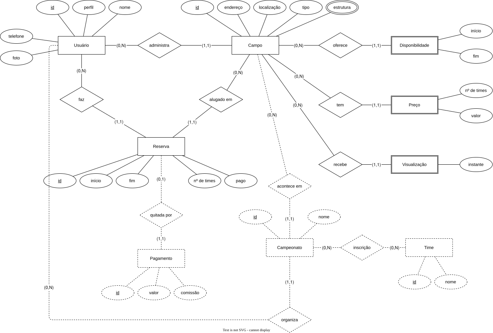

# Modelo de dados

O banco ainda não tem nenhuma migration. Os modelos lógico e físico são desenhados a partir do banco, então
nascem com a primeira migration. Até lá, vale o modelo conceitual abaixo.

## Entidades

| Entidade | Significado | Marco |
| --- | --- | --- |
| Usuário | Uma pessoa com conta e um perfil: gestor ou locatário | M1 |
| Campo | Um campo anunciado por um gestor, com endereço, localização, tipo e estrutura | M1 |
| Disponibilidade | Um intervalo de dia e hora em que o campo pode ser alugado | M1 |
| Preço | O valor do aluguel de um campo para um número de times | M1 |
| Reserva | Um horário de um campo alugado por um locatário, com o número de times e o status de pagamento | M1 |
| Visualização | Uma abertura do anúncio de um campo | M1 |
| Pagamento | O pagamento de uma reserva pelo app, com a comissão retida | M2 |
| Campeonato | Um campeonato num campo, criado por um gestor ou por um locatário | M2 |
| Time | Um time inscrito num campeonato | M2 |
| Inscrição | A vaga que um time ocupa num campeonato | M2 |

## Relações

- Um gestor tem zero ou mais campos; um campo tem exatamente um gestor.
- Um campo tem zero ou mais disponibilidades, preços, reservas e visualizações.
- Um locatário tem zero ou mais reservas; uma reserva tem exatamente um locatário e um campo.
- Uma reserva tem zero ou um pagamento.
- Um campeonato acontece em um campo e tem zero ou mais inscrições; cada inscrição liga um time a um campeonato.

## Invariantes

- Duas reservas de um mesmo campo nunca se sobrepõem no tempo (BR-03).
- Uma reserva tem no mínimo dois times (BR-04).
- A comissão de um pagamento é 5% do valor do aluguel, paga pelo gestor (BR-02).
- Valores em dinheiro são inteiros em centavos de real.
- Horários são instantes com fuso.
- Um gestor só alcança os registros dos próprios campos (NFR-SEC-01).

## Mais

- [Padrões de acesso](access-patterns.md)
- [Armazenamento](storage.md)
