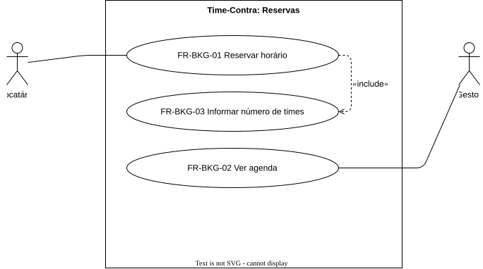

# Reservas (BKG)

O aluguel de um horário e a agenda do gestor.

## FR-BKG-01 — Reservar horário

> Como locatário, quero reservar um horário livre de um campo, para garantir o jogo do meu time.

O sistema deve permitir ao locatário reservar um horário livre de um campo. Se a reserva vale na hora ou depende do
gestor está em aberto: [Q4](../open-questions.md#q4).

| Attribute | Value |
| --- | --- |
| Rationale | O aluguel é o propósito do produto |
| Source | Stakeholder, entrevista de 2026-10-20 |
| Priority | Must |
| Status | approved |
| Milestone | M1 |
| Since | v1.0.0 |

**Acceptance criteria**
- **FR-BKG-01.1** — Given um horário livre, when o locatário o reserva, then a reserva fica registrada em nome dele para esse campo e horário.

## FR-BKG-02 — Agenda do gestor

> Como gestor, quero ver as reservas dos meus campos por data e horário, com quem alugou, para organizar o uso do campo.

O sistema deve exibir ao gestor as reservas dos seus campos por data e horário, com o locatário de cada uma.

| Attribute | Value |
| --- | --- |
| Rationale | O gestor controla quem alugou, quando e em qual campo |
| Source | Stakeholder, entrevista de 2026-10-20 |
| Priority | Must |
| Status | approved |
| Milestone | M1 |
| Since | v1.0.0 |

**Acceptance criteria**
- **FR-BKG-02.1** — Given uma reserva em um campo do gestor, when ele abre a agenda na data da reserva, then a reserva aparece no horário certo com o nome do locatário.

## FR-BKG-03 — Informar número de times

> Como locatário, quero informar quantos times vão jogar, para reservar um horário para todos eles.

O sistema deve registrar na reserva o número de times informado pelo locatário, com mínimo de dois
([BR-04](../business-rules.md#br-04)).

| Attribute | Value |
| --- | --- |
| Rationale | O número de times pode mudar o valor do aluguel |
| Source | Stakeholder, entrevista de 2026-10-20 |
| Priority | Must |
| Status | approved |
| Milestone | M1 |
| Since | v1.0.0 |

**Acceptance criteria**
- **FR-BKG-03.1** — Given um horário livre, when o locatário reserva informando 3 times, then a reserva fica registrada com 3 times.
- **FR-BKG-03.2** — Given um horário livre, when o locatário informa 1 time, then a reserva é recusada.
